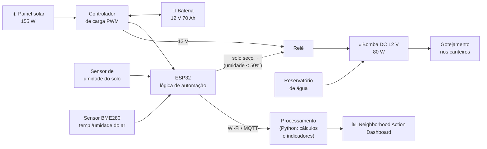

# 🌱 Horta Comunitária Solar — Neighborhood Action Dashboard

**Global Solution 2026.2 · Soluções em Energias Renováveis e Sustentáveis (SERS) · Ciência da Computação – FIAP**

| Integrante | RM | Turma |
| --- | --- | --- |
| Rafael Meirelles Alves Ferreira | RM574688 | 1CCPB |

📹 Vídeo (YouTube, não listado): _colocar o link aqui_

---

## 1. Diagnóstico do problema

**Espaço escolhido:** horta comunitária de referência com **200 m²**, em São Paulo (capital), baseada no modelo de horta comunitária irrigada da Embrapa.

**Problema energético:** a irrigação é feita com **horário fixo (timer)**, sem considerar a umidade do solo nem a chuva. Assim a bomba gasta energia e água mesmo quando as plantas não precisam. Além disso, a horta fica em área aberta, sem ponto de energia: para usar uma bomba elétrica comum é preciso **pedir uma ligação nova à distribuidora** e pagar uma conta mensal.

**Público beneficiado:** moradores e voluntários que cultivam e consomem os alimentos, além de escolas e famílias do bairro (alimentação saudável e educação ambiental).

**Condições de funcionamento:** irrigação diária de cerca de 1.000 L de água a partir de um reservatório (caixa d'água ou cisterna), com a bomba funcionando de dia.

**Benefícios esperados:** independência da rede elétrica, custo de energia zero, menos desperdício de água e dados abertos para a comunidade acompanhar no dashboard.

---

## 2. Análise do consumo energético

Fórmula usada: **E (kWh) = P (W) × t (h) / 1000**

**Necessidade de água**

- Lâmina adotada: **5 L/m² por dia** (1 mm = 1 L/m²). A Embrapa indica de 60 a 100 m³/ha por dia para hortaliças, ou seja, de 6 a 10 L/m². Usamos 5 L/m² porque nem toda a área é canteiro.
- 200 m² × 5 L/m² = **1.000 L/dia**

**Alternativa A – Convencional (rede elétrica + timer fixo)**

| Equipamento | Potência | Uso | Energia |
| --- | --- | --- | --- |
| Bomba periférica ½ cv | 370 W | 1 h/dia (timer) | 370 × 1 / 1000 = **0,37 kWh/dia** |
| **Total no mês (30 dias)** | | | **11,1 kWh/mês** |

**Alternativa B – Solar off-grid + sensor de umidade (ESP32) + gotejamento**

| Equipamento | Potência | Uso | Energia |
| --- | --- | --- | --- |
| Bomba DC 12 V (5,5 L/min = 330 L/h) | 80 W | 1000 ÷ 330 = 3,03 h/dia | 80 × 3,03 / 1000 = **0,242 kWh/dia** |
| ESP32 + sensores | 1 W | 24 h/dia | 1 × 24 / 1000 = **0,024 kWh/dia** |
| **Total (pior caso, bomba todos os dias)** | | | **0,266 kWh/dia ≈ 8,0 kWh/mês** |

Na alternativa B a bomba só liga quando o solo está seco. Na simulação de 30 dias (cerca de 30% dos dias com chuva), o consumo real foi de **5,1 kWh/mês**.

**Dimensionamento do sistema solar**

- Horas de sol pleno (HSP) em São Paulo: **4,5 h/dia**. Rendimento do sistema (perdas): **75%**.
- Painel mínimo = 266 Wh ÷ (4,5 × 0,75) = **79 W** → escolhido **1 painel de 155 W**. Ele custa praticamente o mesmo que um de 100 W e dá folga para o inverno e para dias nublados.
- Geração estimada: 155 × 4,5 × 0,75 = 523 Wh/dia ≈ **15,7 kWh/mês**
- Bateria para 1,5 dia sem sol: 266 × 1,5 ÷ (12 V × 50% de descarga) = **66,5 Ah** → **bateria estacionária de 70 Ah**

**Outras premissas**

- Tarifa Enel SP com impostos: **≈ R$ 1,00/kWh**. A tarifa sem impostos é TUSD R$ 0,43244 + TE R$ 0,29274; somamos os tributos e o reajuste de 10,18% aprovado em jun/2026.
- Ligação monofásica: a distribuidora cobra no mínimo **30 kWh/mês** (custo de disponibilidade), mesmo que o consumo seja menor.
- Fator de emissão da rede: **0,0385 kg CO₂/kWh** (MCTI, Sistema Interligado Nacional, 2023).

---

## 3. Comparação das alternativas

As duas alternativas atendem **a mesma necessidade** (irrigar 1.000 L/dia numa horta de 200 m²) no **mesmo período de referência** (1 mês).

| Critério | A – Rede elétrica + timer | B – Solar + sensor + gotejamento |
| --- | --- | --- |
| Consumo de energia | 11,1 kWh/mês | 5,1 kWh/mês (máx. 8,0) |
| Energia vinda da rede | 11,1 kWh/mês | **0 kWh/mês** |
| Energia renovável | Parcial (mix da rede) | **100% solar** |
| Água usada (simulação) | 45 m³/mês | **18 m³/mês (−60%)** |
| Custo de instalação | R$ 2.305,27 | **R$ 2.159,61** |
| Custo de operação | ≈ R$ 30/mês (mínimo de 30 kWh) | **R$ 0/mês** de energia |
| Custo em 5 anos (instalação + energia) | R$ 4.105,27 | **R$ 2.159,61** |
| CO₂ evitado | — | ≈ 5,1 kg/ano |

### Pesquisa de preços (novembro de 2026)

Os preços foram pesquisados em duas lojas sempre que possível; o valor usado é a média. Os preços são à vista e não incluem frete.

**Alternativa A**

| Item | Loja 1 | Loja 2 | Valor usado |
| --- | --- | --- | --- |
| Bomba periférica ½ cv | Magazine Luiza – Ferrari Acquapump: R$ 149,90 | Loja do Mecânico – Razi BP½: R$ 164,90 | R$ 157,40 |
| Timer digital de tomada | Magazine Luiza – Timer LCD 20 programações: R$ 37,99 | — | R$ 37,99 |
| Microaspersores + mangueira | Magazine Luiza – kit 50 microaspersores: R$ 123,68 | Mercado Livre – mangueira ½" 50 m: R$ 59,90 | R$ 183,58 (soma) |
| Padrão de entrada monofásico | Tabela SINAPI 05/2026 (sem poste): R$ 1.926,30 | Monitor do Mercado (2026): R$ 1.800 a R$ 3.000 | R$ 1.926,30 |
| **Total** | | | **R$ 2.305,27** |

**Alternativa B**

| Item | Loja 1 | Loja 2 | Valor usado |
| --- | --- | --- | --- |
| Painel solar 155 W (Resun) | Mercado Livre: R$ 405,89 | Magazine Luiza: R$ 418,95 | R$ 412,42 |
| Controlador de carga PWM 20 A (Epever LS2024EU) | Magazine Luiza: R$ 157,19 | — | R$ 157,19 |
| Bateria estacionária Moura 12 V 70 Ah (12MN1000) | Magazine Luiza: R$ 665,90 | Mercado Livre: R$ 584,90 | R$ 625,40 |
| Bomba DC 12 V 80 W (5,5 L/min) | Magazine Luiza: R$ 189,00 | — | R$ 189,00 |
| ESP32 DevKit | Magazine Luiza: R$ 57,31 | Mercado Livre: R$ 39,36 | R$ 48,34 |
| Sensores (umidade do solo, BME280) e relé | Magazine Luiza – BME280: R$ 88,00 | — | R$ 120,00 (estimativa do conjunto) |
| Gotejamento | Mercado Livre – fita 1.000 m: R$ 287,87 + mangueira ½" 50 m: R$ 59,90 | Magazine Luiza – 50 conectores: R$ 109,49 | R$ 457,26 (soma) |
| Cabos e suporte do painel | — | — | R$ 150,00 (estimativa) |
| **Total** | | | **R$ 2.159,61** |

Itens com "—" na loja 2 não tinham preço visível em uma segunda loja na data da pesquisa; itens marcados como estimativa não tiveram preço confirmado em loja.

### Viabilidade técnica

- **A:** tecnologia simples e conhecida, mas depende de **levar a rede elétrica até a horta**. Isso exige pedido à distribuidora, poste ou padrão de entrada e prazo de ligação.
- **B:** sistema pequeno de 12 V, sem risco de choque de 127/220 V, que pode ser montado por voluntários com orientação. Precisa de um local com sol para o painel, sem sombra de árvores ou prédios.

### Impactos ambientais

- **A:** consome energia da rede, que no Brasil já é bem limpa, então as emissões são pequenas. O maior impacto é o **desperdício de água**, porque o timer irriga até em dia de chuva.
- **B:** energia 100% solar e **60% menos água** graças ao sensor e ao gotejamento. Ponto de atenção: a **bateria de chumbo-ácido** precisa ser trocada a cada 3–5 anos e **descartada corretamente** (logística reversa).

### Benefícios e limitações

| | Benefícios | Limitações |
| --- | --- | --- |
| **A** | Equipamento barato; funciona com qualquer clima | Conta mensal fixa; desperdiça água; depende de ligação nova |
| **B** | Conta zero; autonomia; economiza água; gera dados para o dashboard | Troca de bateria; produz menos em dias nublados seguidos; risco de furto do painel |

**Conclusão:** a alternativa B é **cerca de R$ 146 mais barata para instalar**, porque dispensa o padrão de entrada. Ela também **zera a conta de energia** e **reduz o consumo de água em cerca de 60%**. Em 5 anos, a economia é de quase R$ 1.950. Como a rede brasileira já é limpa, o ganho de CO₂ é pequeno (≈ 5 kg/ano). Os principais benefícios são **economia de água, autonomia e custo zero de operação**.

---

## 4. Diagrama da solução



**Como funciona:**

1. **Fonte de energia:** o painel solar gera energia de dia. O controlador carrega a bateria, que alimenta o sistema à noite e em dias nublados.
2. **Sensores:** o sensor de umidade mede se o solo está seco; o BME280 mede temperatura e umidade do ar.
3. **Lógica de automação:** o ESP32 lê os sensores e, se a umidade do solo estiver abaixo de 50%, aciona o relé. O relé então libera os 12 V da bateria para a bomba.
4. **Equipamento consumidor:** a bomba leva a água do reservatório até o gotejamento nos canteiros.
5. **Processamento e dashboard:** o ESP32 envia os dados por Wi-Fi/MQTT. O programa em Python calcula os indicadores e mostra tudo no dashboard.

---

## 5. Indicadores de eficiência e sustentabilidade

| Indicador | Unidade | Resultado estimado | Como é calculado |
| --- | --- | --- | --- |
| Consumo de energia | kWh/mês | A: 11,1 · B: 5,1 | Σ P × t / 1000 |
| Energia da rede evitada | kWh/mês | 11,1 | consumo de A − energia da rede em B (0) |
| Redução de custos | R$/mês | 30,00 | máx(consumo A; 30 kWh) × tarifa |
| Participação de energia renovável | % | 100 | energia solar ÷ consumo de B |
| Água economizada | m³/mês | 27 | água usada em A − água usada em B |
| Emissões evitadas | kg CO₂e/ano | 5,1 | 11,1 × 12 × 0,0385 |

---

## 6. Dashboard (código)

O dashboard foi feito em **Python + Streamlit** (`app.py`). Ele mostra os indicadores, a tabela de comparação, gráficos de energia e água por dia, o custo acumulado em 5 anos e o dimensionamento do painel solar.

**Como rodar:**

```bash
pip install -r requirements.txt
streamlit run app.py
```

Os dados de clima e umidade do solo dos 30 dias são **simulados**: cerca de 30% dos dias com chuva, com semente fixa para o resultado ser sempre o mesmo. As premissas ficam no topo do `app.py` e podem ser alteradas.

**Integração com outras disciplinas:** a parte de sensores (ESP32, sensor capacitivo de umidade, BME280, Wi-Fi/MQTT) vem do Projeto Integrador de Arquitetura e Organização de Computadores (Sistema Preditivo de Irrigação com IoT). A contribuição de **SERS** é a análise energética, a comparação das alternativas, o dimensionamento solar e os indicadores deste repositório.

---

## 7. Limitações

- Os valores de economia, geração solar e CO₂ são **projeções** baseadas nas premissas. Não são resultados medidos.
- Os dados de clima e umidade são **simulados**; com sensores reais, os números mudam.
- Os custos são **estimativas de referência**, não um orçamento comercial. Variam com loja, frete e instalação.
- A geração solar cai no inverno e em dias nublados seguidos. A bateria cobre cerca de 1,5 dia sem sol.
- Não foram considerados o custo da água da rede nem a manutenção (troca de bateria a cada 3–5 anos).

---

## 8. Referências

- EMBRAPA. *Sistema de irrigação por gotejamento para horta de 200 m²* (Instruções Técnicas, 2015). https://www.infoteca.cnptia.embrapa.br/infoteca/bitstream/doc/1025428/1/INT122.pdf
- EMBRAPA. *Método prático do tato-aparência do solo para manejo de irrigação em hortaliças*. https://www.infoteca.cnptia.embrapa.br/infoteca/bitstream/doc/1049852/1/CT1462.pdf
- EMBRAPA. *Irrigação de hortaliças* (Circular Técnica 33). https://www.infoteca.cnptia.embrapa.br/infoteca/bitstream/doc/348926/1/Circular200433.PDF
- Irradiação solar em São Paulo (4,5–4,8 kWh/m²/dia na capital). https://www.surgepv.com/pt/solar-compliance/brazil/estado/sao-paulo
- Tarifas Enel SP (TUSD e TE), fatura de fev/2026. https://www.camara.leg.br/cota-parlamentar/documentos/publ/1402/2026/8055366.pdf
- Reajuste tarifário Enel SP 2026 (10,18%). https://istoedinheiro.com.br/conta-de-luz-enel-sao-paulo
- Fator de emissão do SIN 2023 – MCTI (38,5 kg CO₂/MWh). https://www.osetoreletrico.com.br/?p=159478
- Custo do padrão de entrada em 2026. https://monitordomercado.com.br/noticias/410146-quanto-custa-trocar-o-padrao-de-entrada-de-energia-para-suportar-os-novos-aparelhos-da-casa/
- SINAPI 101495 – entrada de energia monofásica (05/2026). https://orcamentor.com/composicao/101495/
- Preços pesquisados no Magazine Luiza (magazineluiza.com.br), Mercado Livre (mercadolivre.com.br) e Loja do Mecânico (lojadomecanico.com.br) em 15/11/2026.
